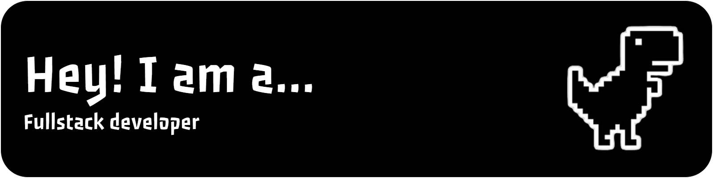

#  My name is Christian, Welcome to my profile!

I'm **Christian**, a Fullstack Developer passionate about crafting efficient web applications and turning ideas into code.

## 🛠️ Tech Stack & Tools

<!--
**alblujan/alblujan** is a ✨ _special_ ✨ repository because its `README.md` (this file) appears on your GitHub profile.

Here are some ideas to get you started:

- 🔭 I’m currently working on ...
- 🌱 I’m currently learning ...
- 👯 I’m looking to collaborate on ...
- 🤔 I’m looking for help with ...
- 💬 Ask me about ...
- 📫 How to reach me: ...
- 😄 Pronouns: ...
- ⚡ Fun fact: ...
-->
